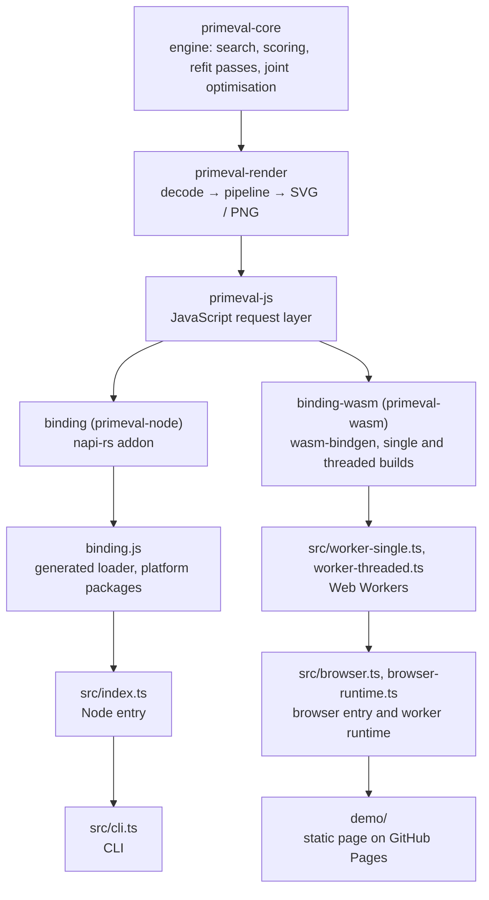

# Architecture

How `primeval` works and how its pieces fit together, as of the code on `main`. The [README](../README.md) covers usage, [`CONTRIBUTING.md`](../CONTRIBUTING.md) the local setup and the runners, [`RELEASING.md`](../RELEASING.md) the release, and [`AGENTS.md`](../AGENTS.md) the rules for changing the code. The history of the engine, with the measurements behind every stage and default named here, is the review log [`algorithm-leap-review-2026-10-07.md`](algorithm-leap-review-2026-10-07.md); this document says what the system is, and points to the log's sections for why.

## 1. What primeval is

`primeval` approximates an image with a fixed number of simple shapes: triangles, rectangles, ellipses, circles, rotated rectangles, quadratic curves, rotated ellipses, convex quadrilaterals, or a mix of all of them (`any`). The goal is a stylised shape version of the picture, such as a small SVG placeholder of 50 to 200 shapes, not pixel fidelity: every shape must read as its kind, and an error change of a few tenths of a level out of 255, which nobody sees, is not worth much time.

The engine is Rust. It searches at a small working resolution (`resizeInput`, 256 px by default) and exports the same shapes as SVG, which scales to any size, or as a PNG at the output size (`outputSize`, 1024 px by default). One npm package, `@domoarigatomrburato/primeval`, ships it three ways:

- a Node API, `approximate()`, on a native addon built with napi-rs;
- the same API in browsers, on WebAssembly in Web Workers;
- a CLI, `primeval`, on the Node API.

## 2. Component map

| Component | Path | Role |
| --- | --- | --- |
| `primeval-core` | [`crates/primeval-core`](../crates/primeval-core/src/lib.rs) | The engine. Takes an RGB target and a background colour, returns a `Drawing`: the shapes as engine-independent geometry. Knows nothing of files, formats or JavaScript. |
| `primeval-render` | [`crates/primeval-render`](../crates/primeval-render/src/lib.rs) | The facade every surface calls: validates options, decodes JPEG, PNG or WebP, runs each kind's pipeline around the engine, and writes SVG or PNG. Owns the defaults and the error codes. |
| `primeval-js` | [`crates/primeval-js`](../crates/primeval-js/src/lib.rs) | Request parsing shared by both bindings: JavaScript values onto `RenderOptions::default`, and the JavaScript spelling of option names and error messages. |
| `binding` (`primeval-node`) | [`binding/src/binding.rs`](../binding/src/binding.rs) | The napi-rs addon: `startApproximate`, run off the event loop, cancellable, panics caught. |
| `binding-wasm` (`primeval-wasm`) | [`binding-wasm/src/lib.rs`](../binding-wasm/src/lib.rs) | The wasm-bindgen module: a synchronous `approximate`, the rayon pool on Web Workers ([`pool.rs`](../binding-wasm/src/pool.rs)) and panic reporting ([`panic.rs`](../binding-wasm/src/panic.rs)). |
| Node entry | [`src/index.ts`](../src/index.ts), [`src/errors.ts`](../src/errors.ts), [`src/native-binding.ts`](../src/native-binding.ts) | The thin TypeScript wrapper over the addon. |
| Shared TypeScript | [`src/types.ts`](../src/types.ts), [`src/request.ts`](../src/request.ts), [`src/result.ts`](../src/result.ts), [`src/data-uri.ts`](../src/data-uri.ts) | Public types, request type checks, result shape and `toDataUri`, used by both entries. |
| CLI | [`src/cli.ts`](../src/cli.ts) | Arguments, files, progress line and exit codes over the Node API. |
| Browser entry | [`src/browser.ts`](../src/browser.ts), [`src/browser-runtime.ts`](../src/browser-runtime.ts), [`src/worker-common.ts`](../src/worker-common.ts), [`src/worker-single.ts`](../src/worker-single.ts), [`src/worker-threaded.ts`](../src/worker-threaded.ts), [`src/worker-protocol.ts`](../src/worker-protocol.ts) | The `browser` condition of the package's `exports`: the same API, run in Web Workers. |
| Demo | [`demo/`](../demo/app.js) | A static page on the browser entry, with a cross-origin isolation service worker ([`demo/coi-sw.js`](../demo/coi-sw.js)). |

### One call, on Node

1. `approximate(request)` ([`src/index.ts`](../src/index.ts)) type-checks the request with `normalizeRequest` ([`src/request.ts`](../src/request.ts)). It checks types only: an absent or `undefined` field stays absent, so Rust chooses its default. An already-aborted signal rejects here, before any native work.
2. The native addon is loaded through `getNativeBinding` ([`src/native-binding.ts`](../src/native-binding.ts)), which requires the generated root `binding.js`. That loader picks the platform's `.node` file, from the repository root in a local build or from the platform package (`@domoarigatomrburato/primeval-<suffix>`), and explains a failure (musl, a missing optional dependency, an old Node).
3. `startApproximate` ([`binding/src/binding.rs`](../binding/src/binding.rs)) converts the fields into `primeval-js`'s `JsRenderOptions`; `normalize_request` parses and range-checks them in Rust and merges them onto `RenderOptions::default`. It returns `{ promise, task }` at once and runs the render on the tokio blocking pool.
4. `primeval_render::approximate` ([`crates/primeval-render/src/lib.rs`](../crates/primeval-render/src/lib.rs)) validates the options, decodes the input within its limits, flattens transparency onto the background, resizes to the working size, and builds a `Model`. It runs `count` greedy steps, reporting each through the progress callback, with the pipeline's passes after some of them, then the final stage, and encodes the chosen `Drawing` as SVG or PNG.
5. Progress reaches `onProgress` through a napi thread-safe function. A throwing `onProgress` or an aborted signal calls `task.cancel()`; the render stops at its next check, and the first reason to stop wins over whatever the native promise settles with. Rust errors arrive with a stable `code` and become `ValidationError`, `AbortError` or `InternalError` (`mapNativeError` in [`src/errors.ts`](../src/errors.ts)).

### One call, in the browser

1. `approximate(request)` ([`src/browser.ts`](../src/browser.ts)) runs the same `normalizeRequest`, copies the input and hands it to `approximateInWorker` ([`src/browser-runtime.ts`](../src/browser-runtime.ts)).
2. The runtime takes the page's idle worker or starts a fresh one of the build the page can run: `threaded` when `crossOriginIsolated` is true, `single` otherwise. The `.wasm` of that build is compiled once per page and sent to the worker.
3. The worker ([`src/worker-common.ts`](../src/worker-common.ts)) instantiates the module once, installs the panic reporter, starts the rayon pool in the threaded build, and calls `binding-wasm`'s `approximate` synchronously on its own thread, posting progress messages as the render goes.
4. The same `primeval-js` and `primeval-render` code runs, so options, defaults, errors and output bytes are those of Node. The result's bytes are transferred back; errors cross as plain `{ code, message, option, requirement }` and are mapped by the Node mapping, so the classes and codes match.

## 3. The engine pipeline (`primeval-core`)

### The model and a step

[`Model`](../crates/primeval-core/src/model.rs) holds the target, the canvas, the raw score (the sum of squared RGB differences between them), the committed shapes with their colours, the error grid, and the seed. The canvas is opaque RGB: backgrounds are opaque and transparent inputs are flattened before the engine sees them. `Model::score_f64` reports the RMSE over the RGB channels divided by 255.

`Model::step` adds one shape. It runs 16 independent search rounds as rayon tasks, one retained worker per round ([`WorkerCtx`](../crates/primeval-core/src/worker.rs)), and paints the best round's shape with its fitted colour. Each round draws from its own ChaCha8 stream, keyed by the seed, the step index and the round index (`round_rng` in [`rng.rs`](../crates/primeval-core/src/rng.rs)); the best energy wins and ties go to the lowest round, so the result does not depend on the number of threads or on scheduling. The canvas lives in a private module that records the rows each committed shape changes, so the structures derived from it update only those rows.

### A search round

Each round ([`WorkerCtx::search_round`](../crates/primeval-core/src/worker.rs)) does what `RoundEffort::of` says for the kind:

| Kind | Random candidates | Climb age | Seeds climbed |
| --- | ---: | ---: | ---: |
| triangle, polygon | 1000 | 75 | 1 |
| circle | 500 | 75 | 1 |
| rotated ellipse | 500 | 100 | 1 |
| quadratic | 500 | 200 | 2 |
| `any`, rectangle, ellipse, rotated rectangle | 1000 | 100 | 1 |

- **Random candidates.** Each candidate is a random shape of the kind (for `any`, of a kind drawn uniformly per candidate). Its position is drawn from the error grid's distribution with probability 0.8 and uniformly otherwise, so the search looks where the canvas is furthest from the target.
- **Coarse ranking.** For `any`, circles, ellipses, rotated ellipses and polygons (`ShapeKind::ranks_coarsely`), candidates are ranked on a 2× box-downsampled copy of the target and canvas ([`coarse.rs`](../crates/primeval-core/src/coarse.rs)), a quarter of the pixels; the best 128 are rescored at full resolution and the best of those are climbed. The other kinds gained almost no time from it and rank at full resolution. A canvas with a side under 32 px gets no coarse copy.
- **Hill climbing.** From each seed, `hill_climb` ([`optimize.rs`](../crates/primeval-core/src/optimize.rs)) makes coarse moves (`σ` 16 px for positions, 32° for angles, alpha ±10 under `alpha: "auto"`) and keeps a move only if it lowers the energy, until `age` moves in a row are rejected. Every move that breaks the kind's rule is undone and drawn again.
- **Bounded evaluations.** Every evaluation after the first in a phase has a bound, the best energy so far, and stops as soon as the candidate cannot beat it: `energy_below` in [`score.rs`](../crates/primeval-core/src/score.rs) subtracts the old error of every covered pixel first, so the running total can only grow afterwards. Before even rasterizing, `WorkerCtx::evaluate` takes the candidate's conservative pixel rectangle (`Shape::candidate_rectangle`) and the old error inside it from a summed-area table in four lookups; that error bounds the error the shape can remove, so a candidate whose best case cannot reach the bound is rejected unrasterized (review log, section 26). None of these early exits changes a result.

### Scoring

The engine optimises the composite the export draws. A blend ([`score.rs`](../crates/primeval-core/src/score.rs)) is the exact composite of a scanline's colour at its coverage and the shape's alpha, rounded once to 8 bits, in fixed point (`M = 0xFFFF`); the PNG writer computes the same composite (review log, section 2).

- **Prefix sums.** [`PrefixSums`](../crates/primeval-core/src/prefix.rs) holds, per row, running sums of the target's and the canvas's channels and of their squared difference, plus a summed-area table of that error. The colour fit reads a line's sums in two lookups instead of its pixels (one-pixel lines, most of the anti-aliased edges, are read directly). They update on the rows a committed shape changed.
- **Error grid.** [`ErrorGrid`](../crates/primeval-core/src/error_grid.rs) splits the canvas into 16 × 16 cells, sums each cell's error from the prefix sums, and keeps the cumulative distribution that random positions are sampled from. It owns the prefix sums and updates with them.
- **Colour fit.** `score::fit` solves the best colour for a candidate's lines at its alpha, weighting each pixel by its coverage, and sums the old error of the covered pixels.
- **Energy.** The candidate's energy is the score minus that old error plus, for every covered pixel, the squared error after blending (`line_after`).
- **SIMD kernels.** The per-line kernels are a trait, `LineKernels`, with a scalar implementation and SIMD ones: NEON on aarch64 (line sums, byte differences and `line_after`, 8 pixels at a time), simd128 on wasm32 (`line_after`, 16 pixels), and AVX2 on x86_64 (`line_after`, 32 pixels), which `energy` and `energy_below` choose at run time with `is_x86_feature_detected!` because the prebuilt addons target the baseline instruction set. Every SIMD kernel equals the scalar one bit for bit (section 4).

### Shapes, rasterizers and legibility

[`shapes.rs`](../crates/primeval-core/src/shapes.rs) defines the eight concrete shapes, their random construction, their moves, and their conversion to `Geometry` ([`drawing.rs`](../crates/primeval-core/src/drawing.rs)). Rasterizers emit scanlines with a 16-bit coverage, each pixel at most once:

- triangles, rectangles, ellipses, circles and rotated rectangles have integer parameters and binary coverage, a pixel covered when its centre is inside;
- polygons and rotated ellipses have continuous parameters and anti-aliased coverage, from four sub-rows per pixel row ([`raster.rs`](../crates/primeval-core/src/raster.rs): `fill_polygon_direct`, `fill_rotated_ellipse_direct`);
- a quadratic curve is a stroke 2 to 6 working pixels wide, chosen and moved by the search, flattened to segments within 0.25 px and covered by the exact share of each pixel's area within half the width of the curve, with round caps (`stroke_quadratic_direct`; review log, sections 14, 15 and 19).

Every shape must read as its kind, in every optimiser, the greedy search included. A triangle keeps every angle strictly above 15°; a polygon is a simple, strictly convex quadrilateral with every angle above 15°; a rectangle, rotated or not, has its long side at most 8 times its short one (`MAX_ASPECT`). The checks (`is_legible_convex`) compare cross and dot products against `tan 15°`, so they compute no angle.

### Refit passes

The greedy step never revisits a shape. A refit pass ([`refine.rs`](../crates/primeval-core/src/refine.rs), `Model::refine`) re-optimises every committed shape at its own layer with the others fixed, top layer first. The layers above layer `i` act on every pixel as one affine map, `final = A · X + B` (`Above`), so a candidate's best colour and energy at layer `i` follow from sums over its covered pixels alone (`Layer`, `Sums`); the module documentation derives the model. At each layer four climbs (`ROUNDS`) on their own `refine_rng` streams start from the committed shape, with moves that start at the greedy search's size and adapt by the 1/5th success rule down to one- and two-pixel moves (`StepScale`), and stop after 25 rejected moves in a row (`AGE`). The best climb replaces the shape only if it is strictly better. The pass keeps canvas checkpoints, about `√N` of them within 64 MiB, and replays each segment between checkpoints once (`replay_plan`; review log, section 16). It is then verified on the exact canvas, repainted from the background, and kept only if the exact score fell.

`Layer::sums` adds its per-pixel terms in a fixed order that SIMD can follow on every target: pixel `j` of a clipped line goes to slot `j mod 4`, the four slots persist across lines and fold as `(((0 + s0) + s1) + s2) + s3`. [`refine/sums.rs`](../crates/primeval-core/src/refine/sums.rs) implements it with NEON, baseline SSE2 and simd128 behind one generic loop, and a scalar version elsewhere, all equal bit for bit (review log, section 25).

### Joint optimisation

[`joint::optimise`](../crates/primeval-core/src/joint.rs) moves every shape at once: every vertex of every triangle and polygon, every side of every rectangle, the centre, half-side vector and half-width of every rotated rectangle, the centre and radii of every ellipse and circle and a rotated ellipse's semi-axis vector, and every opacity under `alpha: "auto"`. Quadratic curves keep their geometry; their colour and opacity are optimised through a fixed coverage mask from the engine's own rasterizer.

- **Differentiable coverage.** The forward model ([`joint/diff.rs`](../crates/primeval-core/src/joint/diff.rs)) covers a pixel of a triangle, a polygon or a rotated rectangle by its exact area in the pixel square: one edge's box-filtered half-plane where only that edge cuts the pixel, the pixel clipped by every cutting edge near a vertex (review log, section 11). An axis-aligned rectangle is the product of its four sides' ramps. A curved outline takes its boundary as locally straight in each pixel (section 13). It composites in `f32`, as the export does.
- **Adam steps.** Each iteration refits every colour by an over-relaxed step that cannot raise the loss, then computes the gradient of the squared error by reverse mode through the layer stack, replayed from `√N` canvas checkpoints, and takes an Adam step. The first vertex step is 1 px, ramped up over a warm-up of 5 iterations so that it does not wreck small, well-placed shapes (`Tuning`; section 12). The number of iterations grows with the shape count: 80 up to 50 shapes, 120 at 200, 160 from 500 (`default_iterations`).
- **Projection.** After every step each shape is projected back onto its kind's rule: minimal Gauss–Newton steps on the angle residuals for triangles ([`joint/angle.rs`](../crates/primeval-core/src/joint/angle.rs)) and polygons ([`joint/convex.rs`](../crates/primeval-core/src/joint/convex.rs)), exact projections for rectangles ([`joint/rect.rs`](../crates/primeval-core/src/joint/rect.rs)) and radii ([`joint/ellipse.rs`](../crates/primeval-core/src/joint/ellipse.rs)). At the end the result snaps to a quarter-pixel lattice (half a pixel for axis-aligned rectangles, [`joint/lattice.rs`](../crates/primeval-core/src/joint/lattice.rs)), repairing any shape the rounding made invalid.
- **Bands and the coverage cache.** Every pass runs as one rayon task per band of 16 rows, its sums reduced in band order. Each band caches the coverage its forward pass computed while the geometry of the whole stack is unchanged, within 32 MiB, so the fit's reverse pass, the replay and the next gradient pass reuse it (section 20).

`joint::optimise` returns a `Drawing` and leaves the model unchanged; `Model::adopt` converts such a drawing back into the engine's shapes, exactly for triangles and polygons, which the triangle pipeline uses during its search (section 10).

### The final stage and its export guard

What runs around the greedy steps is chosen per kind by `pipeline` in [`crates/primeval-render/src/pipeline.rs`](../crates/primeval-render/src/pipeline.rs). The passes during the search follow a `Spaced(interval, divisor)` schedule: after step `interval`, then every `max(interval, s / divisor)` steps, so their cost grows linearly with the count.

| Kind | During the search | Final stage |
| --- | --- | --- |
| `any` | refit passes, `Spaced(20, 5)` | one refit pass, then the joint optimisation of every shape but the quadratics |
| triangle | joint passes of 20 iterations, `Spaced(20, 5)`, kept when the exact canvas scores lower | joint optimisation |
| rectangle, polygon | refit passes, `Spaced(20, 5)` | joint optimisation |
| rotated rectangle | refit passes, `Spaced(20, 2)` | joint optimisation |
| ellipse, circle | refit passes, `Spaced(20, 5)` | joint optimisation |
| rotated ellipse | refit passes, `Spaced(10, 10)` | one refit pass |
| quadratic | refit passes, `Spaced(20, 5)` | refit passes until one gains less than 1%, at most four |

The joint optimisation's result is kept only if its PNG export at the working size is strictly closer to the target than the drawing before it (`better_export`). Its model can disagree with the export, through the snap or on finely fitted stacks, so the guard measures the export itself, in exact integer arithmetic on one thread. The documentation of `pipeline` gives the measurements behind each row; the review log, sections 3 to 13 and 17, the experiments.

### Effort and budgets

Every number above is a budget chosen by measurement on the engine runner's corpus (`examples/engine.rs`, two paintings and three synthetic images, seed 42), by the mean of the 100- and 200-shape median RMSEs of the export, with time weighed against quality: the retune of the pipeline (review log, section 7), the per-kind candidates and ages (section 22, `RoundEffort::of`), the joint iterations (`default_iterations`), the refit pass's `ROUNDS` and `AGE`. Lab hooks behind the `lab` feature (`Model::set_search`, `Model::set_refine_effort` and others, and [`crates/primeval-render/src/lab.rs`](../crates/primeval-render/src/lab.rs)) let the runner change them without changing the defaults.

## 4. Determinism

The same seed and options give the same output at any thread count, and the code is built and tested to give the same output on aarch64, x86_64 and wasm32. The README promises less, the same output on the same platform, and says that native and browser output currently match.

- **Thread independence.** Every random stream is derived from the seed and the position of its work (step and round, or pass, layer and climb), never from a thread; winners are chosen by energy with ties to the lowest index; reductions run in a fixed order (the joint optimisation's sums in band order, the refit's slots in the four-slot order); no rule depends on elapsed time. Tests run the same seeded searches, passes and final stages on pools of different sizes and compare the drawings.
- **Arithmetic.** The engine uses only `+ − × ÷` and `sqrt`, which IEEE 754 rounds exactly, comparisons, `abs`, `min`, `max`, `floor`, `ceil`, `round` and `trunc`. It never uses `mul_add` (a software call in WebAssembly and on x86 without FMA) or the platform's transcendental functions, whose last bit differs between math libraries. Rotations take their sine and cosine from `sin_cos_degrees`, a Taylor polynomial in [`util.rs`](../crates/primeval-core/src/util.rs), and angles from `atan2_degrees`; the PNG writer rotates ellipses with the same `sin_cos_degrees` (review log, section 21). The one transcendental function is `libm::log`, a pure Rust logarithm, in the Gaussian move sampler (Marsaglia's polar method; section 19). [`crates/primeval-core/clippy.toml`](../crates/primeval-core/clippy.toml) bans the other methods (`disallowed-methods`) outside tests and benches, so the clippy gate enforces the list; the `# Arithmetic` section of [`joint.rs`](../crates/primeval-core/src/joint.rs) states it.
- **SIMD equals scalar.** Every SIMD kernel computes exactly what its scalar reference computes: NEON on aarch64, AVX2 chosen at run time and baseline SSE2 on x86_64, simd128 on wasm32. Parity tests (the `simd_parity` modules of [`score.rs`](../crates/primeval-core/src/score.rs) and [`refine.rs`](../crates/primeval-core/src/refine.rs)) compare them bit for bit on random and edge-case lines. CI runs the Rust suite on `macos-15` (NEON) and `ubuntu-24.04` (AVX2, with `PRIMEVAL_REQUIRE_AVX2` set so that a runner without it fails), and `node scripts/build-wasm.mjs test-kernels` runs the score and refit-sums tests on `wasm32-wasip1` under Node's WASI.
- **Pins.** Digest tests pin the greedy output (`seeded_greedy_output_is_pinned` in [`model.rs`](../crates/primeval-core/src/model.rs)), the joint output (`joint_output_is_pinned`), the refit sums, the Gaussian samples and the PNG raster (`raster_output_is_pinned` in [`crates/primeval-render/src/raster.rs`](../crates/primeval-render/src/raster.rs)); every pin holds on aarch64 and x86_64. The browser tests compare SVG and PNG bytes from both WebAssembly builds with the native addon's for every kind and several seeds.

## 5. `primeval-render` and `primeval-js`

[`primeval-render`](../crates/primeval-render/src/lib.rs) is decode, render, encode in one call, `approximate(ApproximateRequest, Execution)`:

- **Options.** `RenderOptions` holds `count`, `shape`, `alpha`, `seed`, `background`, `resize_input` and `output_size`; `RenderOptions::default` is the only place their defaults live (100, `any`, auto, none, auto, 256, 1024). `PartialRenderOptions` carries what a caller set, and `RenderOptions::merge` applies it, so every surface passes absence through. The ranges are constants (`COUNT_RANGE`, `RESIZE_INPUT_RANGE`, `OUTPUT_SIZE_RANGE`), checked before any work.
- **Decode.** [`input.rs`](../crates/primeval-render/src/input.rs) and `decode_input`: JPEG, PNG or WebP through `image`, limited to 16384 px a side and 512 MiB of allocation, at least 2 × 2; the background, explicit or the alpha-weighted mean colour, flattens any transparency; a Catmull-Rom resize gives the working target, and the full-resolution image is freed before the search.
- **Render.** The steps and the pipeline of section 3, checking the `CancellationToken` before every step, between the layers of every refit pass, before every joint iteration, and around decoding and encoding. Each step's `ProgressInfo` carries the step, the total, the score and the shape's SVG element.
- **Encode.** [`svg.rs`](../crates/primeval-render/src/svg.rs) writes the shapes in working coordinates inside a `viewBox`, the root element carrying `stroke-linecap="round"`; [`raster.rs`](../crates/primeval-render/src/raster.rs) renders the same drawing with tiny-skia's anti-aliased high-precision pipeline at the output size and encodes the PNG. [`output.rs`](../crates/primeval-render/src/output.rs) gives the output's size and format names.
- **Errors.** `ApproximateError` ([`error.rs`](../crates/primeval-render/src/error.rs)) has four variants with stable codes, `INVALID_OPTION`, `INVALID_IMAGE`, `ABORTED` and `INTERNAL`; an invalid option names its `RenderOption`, whose `requirement()` is the text every surface prints.

[`primeval-js`](../crates/primeval-js/src/lib.rs) is what both bindings share. Each binding reads its JavaScript values into `JsRenderOptions` (numbers as `f64`, a seed as a number or a `bigint`, `None` for absent), and `normalize_request` parses them with the render crate's parsers and `PartialRenderOptions::set_number`, which rejects a fraction, `NaN` or an out-of-range value instead of truncating it. `js_option_name` maps `resize_input` to `resizeInput` and `output_size` to `outputSize`, the only place that spelling lives; `js_error_fields` gives the `code`, message, `option` and `requirement` a binding puts on its JavaScript error; `panic_error` turns a panic payload into `render panicked: <message>`.

## 6. The bindings

### napi (`binding/`)

[`binding/src/binding.rs`](../binding/src/binding.rs) exports `startApproximate` and `NativeTask`. The render runs on the tokio blocking pool, so the event loop stays free, inside `catch_unwind`: the release profile unwinds, rayon re-raises a worker's panic on the calling thread, and a panic becomes an `INTERNAL` error instead of ending the process. Every render in a process shares rayon's global pool. `npm run build:node` builds the addon (fat LTO) and generates the root `binding.d.ts` and `binding.js`.

The loader ([`scripts/generate-binding.mjs`](../scripts/generate-binding.mjs)) is generated from `package.json`'s `napi.targets`, the one list of native targets: macOS arm64 and x64, Linux GNU arm64 and x64, Windows x64. The same list drives the release matrix, the platform packages, which the release adds to the root package as `optionalDependencies` ([`scripts/release-packages.mjs`](../scripts/release-packages.mjs)), and the artifact checks ([`scripts/napi-targets.mjs`](../scripts/napi-targets.mjs)).

### WebAssembly (`binding-wasm/`)

[`binding-wasm/src/lib.rs`](../binding-wasm/src/lib.rs) exports `approximate(input, output, render, onProgress)`, synchronous on the calling thread, which is a Web Worker. A throwing `onProgress` cancels the render and is rethrown as is. [`scripts/build-wasm.mjs`](../scripts/build-wasm.mjs) builds two variants into `wasm/`, with the `wasm-release` profile, which aborts on panic:

- `wasm/single/`, single-threaded, on the pinned stable toolchain;
- `wasm/threaded/`, with the `threads` feature, on a dated nightly (the standard library rebuilt with atomics, shared memory).

Both require WebAssembly SIMD (`+simd128`): there is no build without it, and the build checks the flag in each module, the shared memory of the threaded one, and a gzip size budget per `.wasm`.

- **The pool** ([`pool.rs`](../binding-wasm/src/pool.rs)): the calling worker creates a `PoolBuilder` for `navigator.hardwareConcurrency` threads and starts that many pool workers, each instantiating the same module on the shared memory and blocking in `startPoolWorker` on the builder's channel; `build` then makes rayon's global pool, whose spawn handler sends each rayon thread to one of them.
- **Panics** ([`panic.rs`](../binding-wasm/src/panic.rs)): a panic aborts the instance without its message, and a panic on a pool thread would leave the calling thread blocked forever. The hook installed by `setPanicReporter` sends `render panicked: <message>` first: on the calling thread through the worker's own port, on a pool thread through a `BroadcastChannel` the page opened for that worker.

## 7. The TypeScript layer

### The Node wrapper

[`src/index.ts`](../src/index.ts) is thin by rule: it type-checks, passes absent fields through, wires `onProgress` and the `AbortSignal` to the native task, and maps errors. Rust owns vocabularies, ranges and defaults. [`src/errors.ts`](../src/errors.ts) defines `PrimevalError` and its subclasses with their `code`, and `mapNativeError`; [`src/native-binding.ts`](../src/native-binding.ts) is the one place that requires the generated `binding.js`, so `npm run build` and `npm run typecheck` work in a clean checkout before any native build. [`src/request.ts`](../src/request.ts) and [`src/types.ts`](../src/types.ts) are shared with the browser entry; only the PNG result's `data` differs (`Buffer` on Node, `Uint8Array` in the browser).

### The CLI

[`src/cli.ts`](../src/cli.ts) parses arguments with `node:util`'s `parseArgs`, reads the input file or stdin, derives the output path and format from the extension, refuses to overwrite without `--force`, shows a progress line on a terminal, and maps errors to exit codes (1 runtime, 2 usage, 130 interrupted). The first Ctrl-C aborts the render through an `AbortController`; a second exits at once.

### The browser runtime

[`src/browser-runtime.ts`](../src/browser-runtime.ts) runs each call in a module Web Worker, so the page's main thread stays free:

- **Build selection.** `threaded` on a cross-origin isolated page, `single` otherwise, chosen before anything is fetched. Literal URLs for both builds and both workers let bundlers see them.
- **Module cache.** Each build's `.wasm` is compiled once per page with `WebAssembly.compileStreaming` and the compiled module is posted to every worker; a failed compile is retried by the next call. A browser without SIMD gets an `InternalError` naming the browsers that have it (a tiny probe module tells a missing SIMD from other load failures).
- **Start gate.** Fresh workers load one at a time (`queueStart`): the next may start only once the previous one, and in the threaded build all its pool workers, have loaded, because WebKit fails module workers started together on a page isolated by a service worker. The threaded worker likewise starts its pool workers one at a time.
- **`init` and `run`.** A fresh worker gets one `init` message, with the compiled module and its panic channel's name, then a `run` message per call; it posts `started`, `progress`, then `result` or `error` ([`src/worker-protocol.ts`](../src/worker-protocol.ts)). [`src/worker-single.ts`](../src/worker-single.ts) and [`src/worker-threaded.ts`](../src/worker-threaded.ts) import their build's glue statically; the threaded file is also each pool worker, told apart by its first message.
- **Idle reuse.** A worker whose call delivered a result stays idle for 10 s, at most one per page, and the next call runs there with its instance, pool and panic channel; every call builds its model and random streams afresh, so a reused worker gives the same bytes as a fresh one. Concurrent calls get separate workers and memory.
- **Cancellation and panics.** Every other outcome, an abort, a throwing `onProgress`, an error or a panic, terminates the worker at once with its instance, memory and pool; that is how an abort stops a synchronous render. An abort before the result arrives wins, as on Node.

The demo ([`demo/`](../demo/app.js)) is plain HTML, CSS and ES modules on this entry. On GitHub Pages, which cannot set headers, [`demo/coi-sw.js`](../demo/coi-sw.js) adds the COOP and COEP headers so the page gets the threaded build; `npm run demo` serves it locally ([`scripts/demo.mjs`](../scripts/demo.mjs)).

## 8. Build, verification and release

The `verify*` scripts in [`package.json`](../package.json) are the single quality path; CI calls them and nothing else repeats their logic. `AGENTS.md` says which check each change needs.

| Script | What it runs |
| --- | --- |
| `verify:rust` | `cargo fmt --check`, `cargo machete`, clippy with and without all features, rustdoc, the workspace tests with all features (the lab tests included) |
| `verify:node` | Biome, knip, the `napi.targets` check, typecheck, `npm run build`, `npm run build:node`, `npm test`, the tooling tests |
| `verify:pack` | `prepare:package` and `npm pack --dry-run` |
| `verify:wasm` | wasm32 clippy, the simd128 kernel tests, both wasm builds, the TypeScript and native builds, the root package contents, the browser tests |
| `verify` | all four |

Generated outputs, never edited by hand: `dist/` (`npm run build`), the root `binding.js`, `binding.d.ts` and `primeval-node.*.node` (`npm run build:node`), `wasm/` (`npm run build:wasm`) and `site/` (`npm run demo:build`).

Workflows in [`.github/workflows/`](../.github/workflows/quality.yml):

- `quality.yml`, on every pull request and push to `main`: `verify:rust` on Linux x64 and macOS arm64, `verify:node` on Node 22, 24 and 26, `verify:pack`, `verify:wasm`, and a hygiene job (typos, actionlint, zizmor, cargo-deny).
- `napi-prebuilds.yml`, on a `v*` tag: the quality workflow, one native build per target on its own runner, checked for its instruction set and glibc floor (`scripts/check-artifact.mjs`) and smoke-tested (`scripts/smoke-test-addon.mjs`), the wasm builds, the publish of the platform packages and then the root package, and the GitHub release. [`RELEASING.md`](../RELEASING.md) describes the flow.
- `pages.yml`, on every push to `main`: builds the package and the demo site and deploys it to GitHub Pages.
- `engine-bench.yml`, manual: builds the engine runner from two refs and runs them interleaved on a GitHub-hosted Linux runner (x64 by default, or arm64), for timings the maintainer's machine cannot give.

The measurement tools live in `primeval-render`'s examples: the engine runner (`engine.rs`, feature `lab`), the README's quality table (`quality.rs`), the comparison with Go `primitive` (`versus_go.rs`) and the gallery (`gallery.rs`); `CONTRIBUTING.md` describes them, with the Divan benches behind each crate's `bench` feature.

## 9. Where to read more

- [`README.md`](../README.md): installation, the Node, browser and CLI usage, deployment notes, benchmarks.
- [`CONTRIBUTING.md`](../CONTRIBUTING.md): local setup, the demo, verification, the benchmark and gallery runners, profiling.
- [`RELEASING.md`](../RELEASING.md): versioning and the release workflow.
- [`AGENTS.md`](../AGENTS.md): the repository's rules, and which check each change needs.
- [`docs/algorithm-leap-review-2026-10-07.md`](algorithm-leap-review-2026-10-07.md): how the engine got here, stage by stage, with the measurements.
- [`docs/gallery.md`](gallery.md): every shape kind on the sample images at several step counts.
- [`docs/plans/`](plans/): the open plans.
